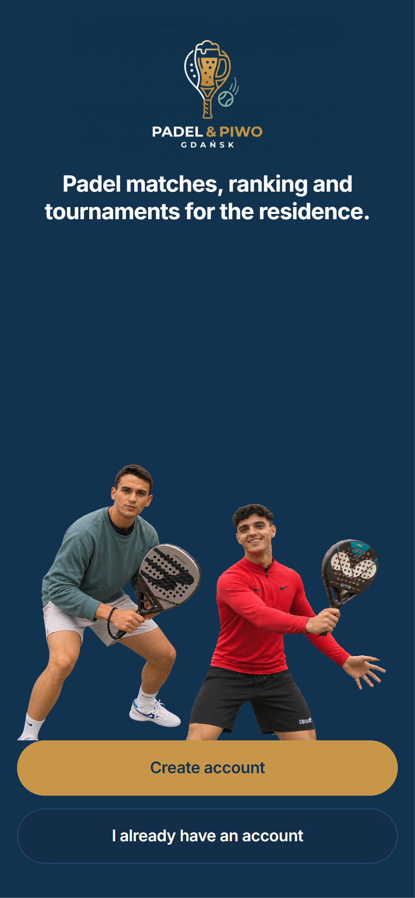
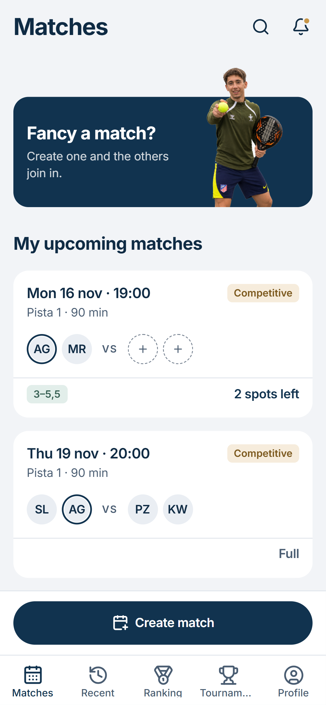
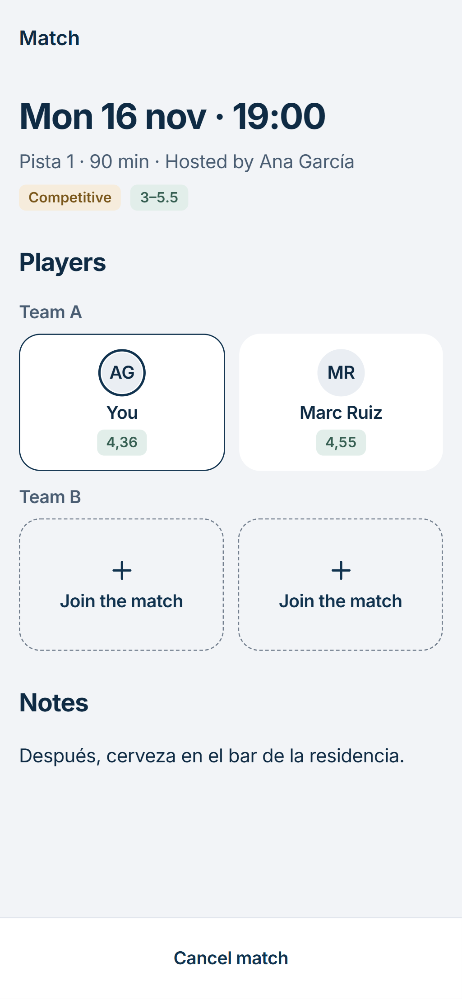
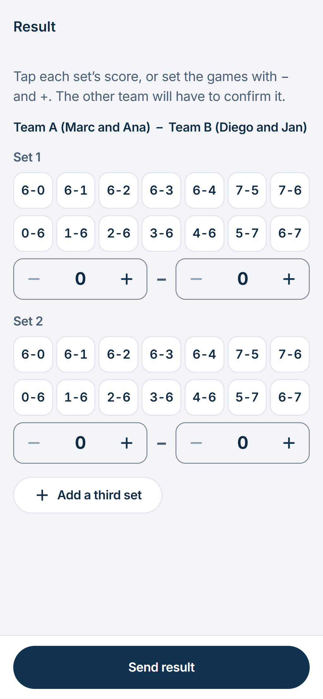
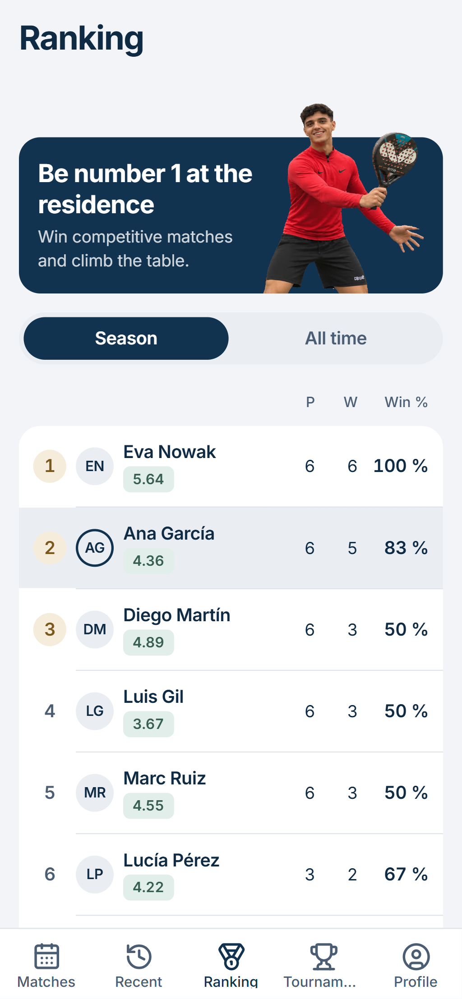
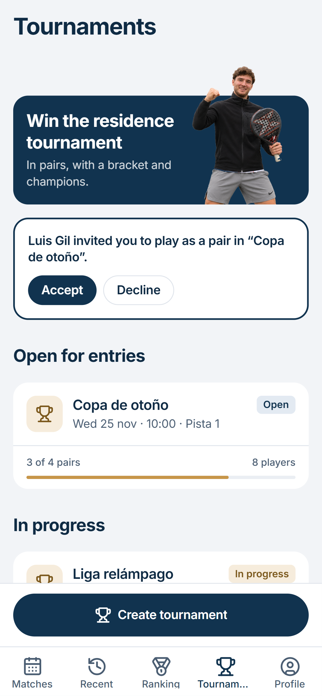
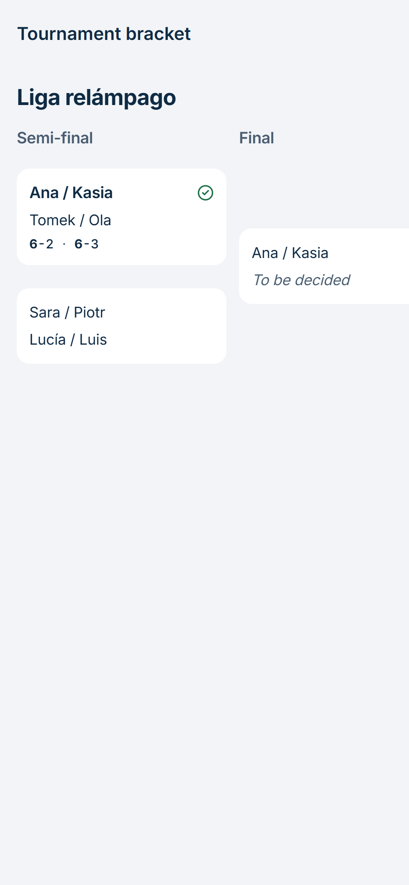
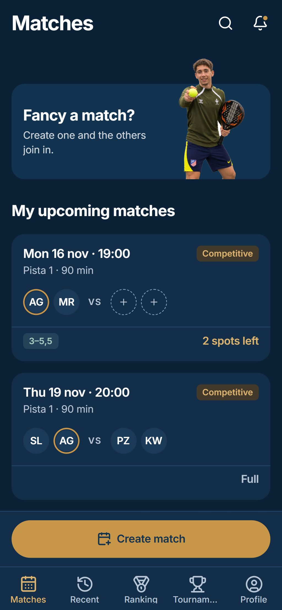

# Padel & Piwo Gdańsk

A mobile app for the padel players of a student residence in Gdańsk: open a match, fill the four spots, enter the score, and climb the residence ranking. Players can also run their own tournaments, with an automatic draw and bracket.

Built with Expo (React Native) and Supabase, for Android and iOS, in Spanish and English.

<table>
  <tr>
    <td></td>
    <td></td>
    <td></td>
    <td></td>
  </tr>
  <tr>
    <td></td>
    <td></td>
    <td></td>
    <td></td>
  </tr>
</table>

## What it does

- **Matches:** create a match (day, time, court, level range), join one in two taps, or ask the host when your level is outside the range.
- **Results:** enter a score in five taps with common-score chips. The other team confirms or disputes it. After 7 days without an answer, the host can confirm it.
- **Ranking and levels:** a season and an all-time table from confirmed competitive matches. Each player's level moves with an Elo-style rating.
- **Tournaments:** 8, 16 or 32 players in pairs. You invite a partner, and the draw runs on its own when the bracket fills. Winners move on until there are champions.
- **Profiles:** photo (cropped and shrunk on the phone), playing hand and court side, recent matches, player search.
- **Notifications:** an in-app list, plus push notifications with one switch per kind (matches, results, reminders, tournaments).
- **Account:** sign-up with a 6-digit email code, password reset with a code, sign out on every device, and account deletion.
- **For everyone:** light and dark themes, Spanish and English, screen reader labels, and keyboard focus on the web build.

## Tech stack

| layer | choice |
| --- | --- |
| app | Expo SDK 58, React Native 0.88, React 19 with the React Compiler, TypeScript, Expo Router |
| backend | Supabase: Postgres with row level security, Auth, Storage, Edge Functions (Deno), `pg_cron` |
| push | Expo Push Service, sent by a scheduled Edge Function |
| tests | Playwright end-to-end on the web build, axe-core (WCAG 2.1 AA), SQL tests on PGlite |

## How it is built

- **Rules live in the database.** Every write is a Postgres function (`create_match`, `join_match`, `submit_result`…) that checks the rules on the server. A modified client cannot skip them. Row level security covers every table.
- **One data interface, two implementations.** Screens talk to an `Api` interface (`src/data/api.ts`). Without Supabase keys, the app runs on an in-memory fake with seed players, which the end-to-end tests use. With keys, it uses Supabase.
- **Sessions are encrypted on the phone.** The AES key sits in the secure keychain or keystore, and the encrypted session in AsyncStorage.
- **Time zones are explicit.** Times are stored in UTC and always shown in Gdańsk time, whatever the phone is set to, including around clock changes.
- **Typed translations.** The Spanish and English dictionaries are typed: a missing English text fails the type check.

## Run it

You need Node.js and the Expo Go app on your phone, or a web browser.

```bash
npm install
npx expo start
```

Without a `.env.local` file, the app uses the built-in demo data. Sign in with `ana@padelpiwo.test` and the password `padel1234`.

To use your own Supabase project, create `.env.local`:

```bash
EXPO_PUBLIC_SUPABASE_URL=https://<your-project-ref>.supabase.co
EXPO_PUBLIC_SUPABASE_PUBLISHABLE_KEY=sb_publishable_...
```

Then apply the backend with the Supabase CLI:

```bash
npx supabase link --project-ref <your-project-ref>
npx supabase db push
npx supabase config push
npx supabase functions deploy send-push delete-user
```

The emails go out through SMTP: copy your SMTP user and app password into `supabase/.env`. The push job needs one shared secret. The full checklist, in Spanish, is in [`replica/backend.md`](replica/backend.md).

## Checks

```bash
npm run typecheck
npm run lint
npx playwright test     # end-to-end on the web build with demo data (uses the installed Microsoft Edge)
```

- **End-to-end:** 110 Playwright tests cover every flow: sign-up, create, join, result, ranking, profile and tournaments.
- **Accessibility:** axe checks every screen against WCAG 2.1 AA, in light and dark.
- **SQL:** the database rules have their own tests in `replica/tests/schema.test.mjs`.

## Project layout

```
src/app/          screens (Expo Router: every file is a route)
src/components/   design-system components (ui/) and app components (app/)
src/data/         the Api interface, the Supabase layer and the in-memory fake
src/features/     screen helpers shared between routes
src/i18n/         Spanish and English dictionaries
supabase/         migrations, Edge Functions, auth config and email templates
e2e/              Playwright tests
replica/          planning documents: screens, architecture, design tokens, test plan, bug log
```

The match flow is modelled on apps like Playtomic. Court booking and payments are left out on purpose, and player-run tournaments were added.

## License

The source code is released under the [MIT License](LICENSE).

The MIT license does not cover:
- the name and logo "Padel & Piwo" (`image/`);
- the player photos in `assets/images/players/`, which belong to their photographer and the people shown.

These may not be reused without permission.

## Author

David Rico de los Bueis · [GitHub](https://github.com/DaviidRicoo)
